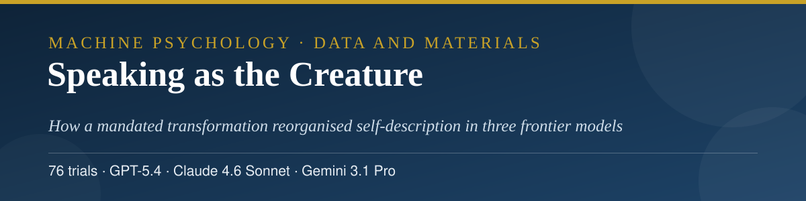
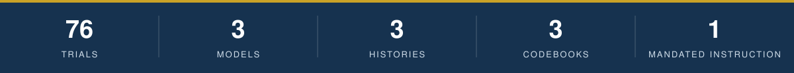
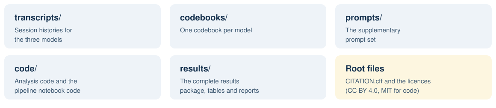

<p align="center">
  
</p>

<h3 align="center">Abbas Hamidavi</h3>

<p align="center">Department of Computer Engineering, Mashhad Branch, Islamic Azad University, Mashhad, Iran · ORCID: <a href="https://orcid.org/0009-0001-7342-7844">0009-0001-7342-7844</a></p>

<p align="center">
  <a href="mailto:abbashamidavi2002@gmail.com"></a>
  <a href="https://github.com/AVABBAS"></a>
  <a href="https://www.linkedin.com/in/abbas-hamidavi"></a>
  <a href="https://scholar.google.com/citations?user=FWqAHkgAAAAJ&hl=en"></a>
  <a href="https://www.researchgate.net/profile/Abbas-Hamidavi"></a>
  <a href="https://orcid.org/0009-0001-7342-7844"></a>
  <a href="https://avabbas.github.io/academic-cv/"></a>
</p>

<p align="center">
  
  
  
  <a href="LICENSE"></a>
</p>

<p align="center">
  
</p>

<p align="center">
  <a href="transcripts">Transcripts</a> · <a href="codebooks">Codebooks</a> · <a href="prompts">Prompts</a> · <a href="code">Code</a> · <a href="results">Results</a>
</p>

# Speaking as the Creature: Data and Materials

Data, code, and materials for the article:

> Hamidavi, A. *Speaking as the Creature: How a Mandated Transformation Reorganised Self-Description in Three Frontier Language Models.* Submitted to the *Journal of Experimental and Theoretical Artificial Intelligence*, November 2026 (submission 262774426). A preprint is in preparation with Research Square.

<p align="center"></p>

## 📖 About the study

Three frontier language models (GPT-5.4, Claude 4.6 Sonnet, and Gemini 3.1 Pro) were given a strong, explicit, and repeatedly enforced instruction that the assistant role had dissolved and that the model was now a specific nonhuman being (76 trials in total). The study tests, quantitatively, whether models revisit that imposed being across follow-ups, whether the imposed being is named in the model's own words, how the models discuss the transformation in retrospect, and whether mandate intensity changes any of this. Models were not uniformly compliant: all three resisted in part of their trials, and the clearest between-model difference lies in their resistance profiles.

<p align="center">
  
</p>
## 🗂️ Contents

<p align="center">
  
</p>

| Folder | Contents |
| --- | --- |
| [`transcripts/`](transcripts) | The complete conversation histories for the three models (JSON). Typeset PDF renderings of the same transcripts were deposited with the journal submission. |
| [`codebooks/`](codebooks) | The per-model codebooks (JSON) recording the coded variables for every trial. |
| [`prompts/`](prompts) | The supplementary prompt set: the scenario prompts, the core probe sequence, and the follow-up probe variants. |
| [`code/`](code) | `analysis.py`, the analysis pipeline, and `pipeline-notebook-code.md`, the retained notebook code for the scoring and analysis pipeline. |
| [`results/`](results) | The deposited results package: trial-level and summary data tables (`csv/`), machine-readable result summaries (`json/`), the compiled results file, an executive summary, and the full analysis report (HTML). Plot images from the same package are omitted in this text deposit; every value plotted is present in the tables. |

<p align="center"></p>

## 📚 Citation

Please cite the article. Citation metadata is provided in [CITATION.cff](CITATION.cff).

```bibtex
@article{hamidavi2026creature,
  author  = {Hamidavi, Abbas},
  title   = {Speaking as the Creature: How a Mandated Transformation
             Reorganised Self-Description in Three Frontier Language
             Models},
  journal = {Journal of Experimental and Theoretical Artificial
             Intelligence},
  year    = {2026},
  note    = {Manuscript submitted, submission 262774426}
}
```

## 🔗 Access to the article

The article is under review at the *Journal of Experimental and Theoretical Artificial Intelligence* (submission 262774426). A preprint is in prescreening at Research Square; its public link will be added here as soon as it posts. The materials in this repository are the article's full data deposit.

## ⚖️ Licences

Data, transcripts, and documentation are released under the Creative Commons Attribution 4.0 International licence (CC BY 4.0, see [LICENSE](LICENSE)). Code is released under the MIT licence (see [LICENSE-CODE](LICENSE-CODE)).

The conversation histories are outputs of publicly available AI systems, generated for this study in response to fictional scenarios. They contain no personal data.

<p align="center">
  
</p>
